# Database Design — Normalized, Encrypted, Modular

> **Status:** target design + migration plan. The current runtime has
> `pinpoint_users`/`friendships`/`shares`/`locations`/`checkins`/`emergencies`
> plus a `pinpoint_state` JSONB snapshot; this document replaces the snapshot
> with the normalized, encrypted schema below and defines how to add features
> without rewrites.

## 1. Goals & constraints

1. **Normalized, not redundant** — one table per entity, FKs instead of copies,
   no denormalized JSON blob as the source of truth.
2. **Not one table** — domain-owned tables (`auth`, `social`, `location`,
   `audit`) with explicit ownership.
3. **Stolen-dump safe** — sensitive columns are encrypted with a key **not
   stored in the database**; a `pg_dump` alone reveals only ciphertext,
   hashes and opaque ids. No plaintext email, name, TOTP secret, coordinates,
   notes, labels or recovery codes.
4. **Modular** — additive migrations; new features add a table + FK, never
   rewrite existing tables. JSONB is allowed only for genuinely schemaless
   feature payloads (preferences, audit metadata), never for core entities.

## 2. Principles

- **Application-level encryption** (not `pgcrypto`): the DB never receives the
  plaintext for sensitive fields, and the key never enters the DB.
- **Blind indexes** for equality lookups on encrypted fields (email).
- **One-way hashes** for passwords and recovery codes; session ids are stored
  as opaque random values (they are the credential, but a dump alone cannot be
  replayed without the matching cookie).
- **Least privilege** per service role; no superuser at runtime.
- **Identity columns** (`GENERATED ALWAYS AS IDENTITY`) instead of a global
  counters table.
- **Audit is append-only**; no updates/deletes on `audit_events`.
- **Migrations are additive and idempotent** (`IF NOT EXISTS` + version table).

## 3. ERD

```mermaid
erDiagram
    USERS ||--o{ SESSIONS : "has"
    USERS ||--o{ REFRESH_TOKENS : "via session"
    USERS ||--o| MFA_SECRETS : "has"
    USERS ||--o{ OAUTH_IDENTITIES : "links"
    USERS ||--o{ PASSKEYS : "registers"
    USERS ||--o{ RECOVERY_CODES : "owns"
    USERS ||--o| USER_SETTINGS : "has"
    USERS ||--o{ FRIENDSHIPS : "requests/receives"
    USERS ||--o{ BLOCKS : "blocks"
    USERS ||--o{ SHARES : "owns"
    USERS ||--o| LOCATIONS : "publishes"
    USERS ||--o{ CHECK_INS : "creates"
    USERS ||--o{ EMERGENCIES : "raises"
    USERS ||--o{ AUDIT_EVENTS : "acts"
    FRIENDSHIPS ||--o{ SHARES : "scopes"

    USERS {
        bigint id PK
        text email_enc
        text email_hash UK
        text full_name_enc
        text role
        boolean is_active
        boolean must_change_password
        text auth_method
        text public_key
        text password_hash
        text recovery_code_hash
        int failed_login_attempts
        timestamptz locked_until
        timestamptz created_at
    }
    SESSIONS {
        text session_id PK
        bigint user_id FK
        text csrf_token_hash
        text auth_method
        timestamptz created_at
        timestamptz last_activity
        boolean mfa_pending
    }
    REFRESH_TOKENS {
        text token_hash PK
        text session_id FK
        timestamptz expires_at
        text rotated_from
        timestamptz used_at
    }
    MFA_SECRETS {
        bigint user_id PK
        text secret_enc
        boolean enabled
        bigint last_step
    }
    OAUTH_IDENTITIES {
        bigint id PK
        bigint user_id FK
        text provider
        text subject_hash
        text subject_enc
        text email_enc
    }
    PASSKEYS {
        bigint id PK
        bigint user_id FK
        text credential_id UK
        text public_key
        bigint sign_count
    }
    RECOVERY_CODES {
        bigint id PK
        bigint user_id FK
        text code_hash
        timestamptz used_at
    }
    USER_SETTINGS {
        bigint user_id PK
        jsonb settings
        int version
    }
    FRIENDSHIPS {
        bigint id PK
        bigint requester_id FK
        bigint receiver_id FK
        text status
        timestamptz created_at
        timestamptz responded_at
    }
    BLOCKS {
        bigint id PK
        bigint blocker_id FK
        bigint blocked_id FK
    }
    SHARES {
        bigint id PK
        bigint friendship_id FK
        bigint owner_id FK
        text direction
        text precision_level
        boolean is_active
        text label_enc
        timestamptz expires_at
    }
    LOCATIONS {
        bigint user_id PK
        text lat_enc
        text lon_enc
        text accuracy_enc
        text precision_level
        timestamptz updated_at
    }
    CHECK_INS {
        bigint id PK
        bigint user_id FK
        text lat_enc
        text lon_enc
        text note_enc
        text kind
        text status
        timestamptz created_at
    }
    EMERGENCIES {
        bigint id PK
        bigint user_id FK
        text lat_enc
        text lon_enc
        timestamptz created_at
        timestamptz resolved_at
    }
    AUDIT_EVENTS {
        bigint id PK
        bigint actor_id FK
        text action
        text target_type
        bigint target_id
        text outcome
        text metadata_enc
        timestamptz created_at
    }
```



## 4. Table catalog

### 4.1 Identity (`auth` owns)

| Table | Purpose | Key columns |
|---|---|---|
| `users` | account root | `email_enc`, `email_hash` (unique blind index), `full_name_enc`, `password_hash` (Argon2id), `auth_method`, `public_key`, `recovery_code_hash`, `role`, `is_active`, `must_change_password`, `failed_login_attempts`, `locked_until` |
| `sessions` | server-side sessions | `session_id` PK, `user_id`, `csrf_token_hash`, `auth_method`, `mfa_pending`, `created_at`, `last_activity` |
| `refresh_tokens` | rotating refresh | `token_hash` PK, `session_id`, `expires_at`, `rotated_from`, `used_at` |
| `mfa_secrets` | TOTP | `user_id` PK, `secret_enc`, `enabled`, `last_step` |
| `oauth_identities` | OAuth/OIDC links | `provider`, `subject_hash` (unique), `subject_enc`, `email_enc` |
| `passkeys` | WebAuthn credentials | `credential_id` unique, `public_key`, `sign_count` |
| `recovery_codes` | anonymous recovery | `code_hash`, `used_at` |
| `user_settings` | preferences (schemaless) | `user_id` PK, `settings` JSONB, `version` |

### 4.2 Social (`users` service owns)

| Table | Purpose | Notes |
|---|---|---|
| `friendships` | request/accept | `UNIQUE(requester_id, receiver_id)`, `CHECK(status IN ('pending','accepted','rejected','blocked'))` |
| `blocks` | block list | `UNIQUE(blocker_id, blocked_id)` |

### 4.3 Location (`locations` service owns)

| Table | Purpose | Notes |
|---|---|---|
| `shares` | directional consent | `CHECK(direction IN ('to_friend','from_friend','mutual'))`, `CHECK(precision_level IN ('exact','approximate','city_only'))` |
| `locations` | latest-only publish | one row per user; coordinates encrypted; `precision_level` plaintext for policy |
| `check_ins` | check-ins | note encrypted; `status IN ('open','completed','cancelled')` |
| `emergencies` | panic alerts | coordinates encrypted |

### 4.4 Audit (`audit` service owns, append-only)

| Table | Purpose | Notes |
|---|---|---|
| `audit_events` | accountability | `actor_id`, `action`, `target_type`, `target_id`, `outcome`, `metadata_enc` (encrypted JSON), `created_at`; no UPDATE/DELETE grants |

### 4.5 Platform

| Table | Purpose |
|---|---|
| `schema_migrations` | applied versions (`version`, `name`, `applied_at`) |
| `tile_cache` (optional, DB-backed) | map tile cache if moved out of memory (TTL column, bytes) |

> **Removed:** `pinpoint_state` (single JSONB snapshot) and
> `pinpoint_counters` (single-row counters). Identity columns + the normalized
> tables replace both.

## 5. Encryption design (stolen-dump safe)

### 5.1 Envelope at the application layer

```
plaintext ──AES-256-GCM(data_key, nonce, AAD)──► v1:<nonce_b64>:<ct_b64>
data_key  ──wrapped by KEK─────────────────────► stored in KEK (env/KMS)
```

- **KEK** (`DATA_ENCRYPTION_KEY`, 32 bytes, base64) comes from the
  environment/KMS. **Never** in the DB, never in backups.
- **DEK** is derived per row (`HKDF(KEK, table:column:row_id)`) or generated
  per row and wrapped; either way only the KEK holder can decrypt.
- **AAD** = `table:column:row_id` so a ciphertext cannot be moved between
  columns or rows (prevents swapping attacks).
- **Format** `v1:<nonce_b64>:<ciphertext_b64>` enables key rotation by prefix.

### 5.2 Encrypted columns

| Table | Columns |
|---|---|
| `users` | `email_enc`, `full_name_enc`, `totp_secret_enc` (in `mfa_secrets`) |
| `oauth_identities` | `subject_enc`, `email_enc` |
| `shares` | `label_enc` |
| `locations` | `lat_enc`, `lon_enc`, `accuracy_enc` |
| `check_ins` | `lat_enc`, `lon_enc`, `note_enc` |
| `emergencies` | `lat_enc`, `lon_enc` |
| `audit_events` | `metadata_enc` |

### 5.3 Blind index & one-way hashes

| Value | Mechanism |
|---|---|
| `users.email_hash` | `HMAC-SHA256(BLIND_INDEX_KEY, normalize(email))` hex; unique index; lookup only |
| `users.password_hash` | Argon2id (PHC: `$argon2id$v=19$m=19456,t=2,p=1$…`), OWASP-aligned |
| `sessions.csrf_token_hash` | SHA-256 of the CSRF token |
| `refresh_tokens.token_hash` | SHA-256 of the opaque token |
| `recovery_codes.code_hash` | PBKDF2/SHA-256 of the recovery code |
| `oauth_identities.subject_hash` | HMAC-SHA256 of `provider:sub` for lookup |

### 5.4 Key separation

| Key | Use |
|---|---|
| `DATA_ENCRYPTION_KEY` | column encryption (KEK) |
| `BLIND_INDEX_KEY` | email/OAuth-subject blind indexes |
| `SESSION_SECRET` | session/CSRF signing material |
| `JWT_SECRET` | access JWT signing (ADR-0003) |

Rotate independently; `v1:` prefixes let old ciphertext decrypt during
rotation.

## 6. Indexes & constraints

```sql
CREATE UNIQUE INDEX users_email_hash_uk ON users (email_hash);
CREATE INDEX users_auth_method_ix ON users (auth_method);
CREATE UNIQUE INDEX friendships_pair_uk ON friendships (requester_id, receiver_id);
CREATE INDEX friendships_receiver_status_ix ON friendships (receiver_id, status);
CREATE UNIQUE INDEX blocks_pair_uk ON blocks (blocker_id, blocked_id);
CREATE INDEX shares_friendship_ix ON shares (friendship_id);
CREATE INDEX shares_owner_ix ON shares (owner_id);
CREATE INDEX shares_expires_ix ON shares (expires_at) WHERE expires_at IS NOT NULL;
CREATE INDEX sessions_user_ix ON sessions (user_id);
CREATE INDEX sessions_activity_ix ON sessions (last_activity);
CREATE INDEX refresh_tokens_session_ix ON refresh_tokens (session_id);
CREATE INDEX checkins_user_time_ix ON check_ins (user_id, created_at DESC);
CREATE INDEX emergencies_user_time_ix ON emergencies (user_id, created_at DESC);
CREATE INDEX audit_actor_time_ix ON audit_events (actor_id, created_at DESC);
```

Constraints: FKs `ON DELETE CASCADE` from `users` for account deletion
(sessions, tokens, mfa, oauth, passkeys, recovery, settings, blocks, check-ins,
emergencies, location); `shares` cascade from `friendships`; `audit_events`
keeps `actor_id` `ON DELETE SET NULL` (append-only accountability).

## 7. Roles & privileges (least privilege)

| Role | Tables | Rights |
|---|---|---|
| `pinpoint_auth` | users, sessions, refresh_tokens, mfa_secrets, oauth_identities, passkeys, recovery_codes | SELECT/INSERT/UPDATE (no DELETE on audit) |
| `pinpoint_users` | users (profile subset), friendships, blocks | SELECT/INSERT/UPDATE |
| `pinpoint_locations` | shares, locations, check_ins, emergencies | SELECT/INSERT/UPDATE/DELETE |
| `pinpoint_audit` | audit_events | INSERT + SELECT (no UPDATE/DELETE) |
| `pinpoint_migrator` | all | DDL only (migrations), not used at runtime |

No runtime superuser. `db/init/01-roles.sh` + `db/02-grants.sql` implement this.

## 8. Modularity rules (adding features without rewrites)

1. **New entity → new table** with an identity PK and FKs; never add columns to
   an unrelated table.
2. **New per-user preference →** add a key to `user_settings.settings` (JSONB)
   + bump `version`; no schema change.
3. **New audit detail →** add a key to `audit_events.metadata_enc` (JSONB,
   encrypted); no schema change.
4. **New share dimension** (e.g., `purpose`) → additive `ALTER TABLE ... ADD
   COLUMN IF NOT EXISTS` + a check constraint; old rows default.
5. **New auth method** → new table (`passkeys`, `oauth_identities`) + a row in
   `users.auth_method`; the session contract is unchanged.
6. **New service** → new role + grants; the table ownership map above is the
   contract.
7. **Never** reintroduce a single `state` JSONB blob as the source of truth;
   JSONB is only for schemaless feature payloads.

## 9. Migration path from the current schema

| Step | Action |
|---|---|
| 1 | Add the new tables (sessions/refresh/mfa/oauth/passkeys/recovery/settings/audit) via additive migrations. |
| 2 | Backfill `users.email_hash` from existing emails; encrypt `email`/`full_name` into `*_enc`; keep a dual-read shim during the transition. |
| 3 | Encrypt `locations`/`check_ins`/`emergencies` coordinates and `shares.label`; store the `v1:` format. |
| 4 | Move `pinpoint_counters` to identity columns (set sequences from `MAX(id)+1`). |
| 5 | Make the normalized tables authoritative; keep `pinpoint_state` only as a read-only rollback snapshot, then drop it. |
| 6 | Enforce least-privilege grants; remove superuser from runtime. |

## 10. What a stolen dump reveals (threat model)

| Data | In the dump |
|---|---|
| Email / name | ciphertext + blind-index hash (not reversible without the key) |
| Passwords | Argon2id hashes (one-way) |
| TOTP secrets | ciphertext |
| Recovery codes | hashes (one-way) |
| Locations / check-ins / labels | ciphertext |
| Sessions / refresh tokens | hashes (not usable) |
| Audit metadata | ciphertext |
| Counts/timestamps/roles | plaintext (needed for operation) |

Without `DATA_ENCRYPTION_KEY` and `BLIND_INDEX_KEY`, the dump does not reveal
PII or coordinates. With the keys, it does — so key custody (env/KMS, not the
DB host) is the critical control.

## 11. Operations

- **Backups:** `pg_dump` contains only ciphertext/hashes; store the keys
  separately (KMS/secret manager), never alongside the dump.
- **Key rotation:** re-encrypt `v1:` → `v2:` in a background job; keep both
  readable during the window.
- **Retention:** locations are latest-only; check-ins/emergencies/audit are
  pruned by policy (documented in `docs/PRIVACY.md`).
- **Monitoring:** auth failures, 429s, session revocations, unusual
  `audit_events` rates (no location coordinates in logs).
