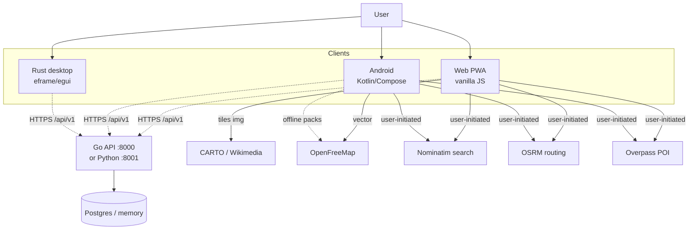
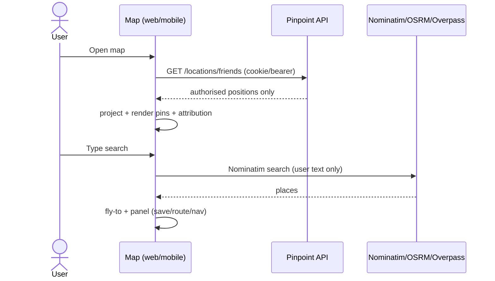

# 08 — Architecture

## C4 overview (Mermaid — full diagrams in `docs/uml/`)

## Module boundaries

### Web (`web/public/js/`)
`config` → endpoints/layers · `api` → only `/api/v1` fetcher · `session` →
cookie bootstrap · `ui` → `esc()`/toast · `map` → Slippy engine + overlays ·
`geocode`/`routing`/`places` → OSM services · `bookmarks` → localStorage ·
`navigation` → `geo:`/GPX · `main` → wiring. Zero deps, zero bundler.

- **Slippy projection:** Web Mercator `lngLatToWorld`/`worldToLngLat`
  (256 px tiles); tiles are `` in a viewport grid; markers/route are
  absolutely-positioned divs/SVG polyline.
- **Overlays:** friends (authorised coords only), me, search pin, selected,
  POIs, route line — rendered from projected screen positions.

### Android (`mobile/`)
Clean Architecture (see 06 TR-02). `network` owns Retrofit/OkHttp + OSM
DTOs; `data` owns repo impls + DataStore bookmarks + Keystore sessions;
`map` owns MapLibre + `OfflineMapManager` + `MapLayers`; `feature:map`
owns Compose screens + ViewModels (domain-only + map public API).

### Rust (`src/`)

`api` (reqwest) → `models` → `app` (MVI-ish + patterns/security) → `map` (pins + links).

- `patterns/` — Repository, Strategy, Command, State, Observer, Factory,
  Decorator, Proxy. See `docs/design-patterns.md`.
- `security/` — validation, rate_limit, encryption (AES-256-GCM), audit,
  session (timeout), signing (HMAC-SHA256). See `docs/security-architecture.md`.
- Map-first: `CurrentScreen::Map` is the default screen; `StateContext`
  synchronizes with `PinpointApp::current_screen` on every `set_screen()`;
  `requires_sign_in()` delegates to the State pattern.

Transport is HTTPS-only except loopback (ADR-0006).

### Backend
Go: `cmd/server` → `handlers` → `store` (memory/Postgres) + `security`.
Python mirrors the contract. Precision downgrade + consent at read time.

## Data flow (map example)

## Extension points

- New tile provider: change config + CSP (no code redesign).
- Real offline routing: implement `RoutingEngine` with GraphHopper/Valhalla.
- Realtime: WebSocket for `location.updated` (consent-checked).
- Check-ins/trails: own threat analysis + consent semantics first.

## ADRs

See `docs/adr/` (0001–0003, 0006, + map/UX ADRs). New map decisions are
recorded in 07 + `docs/sdlc/`; architecture-significant ones need an ADR.
