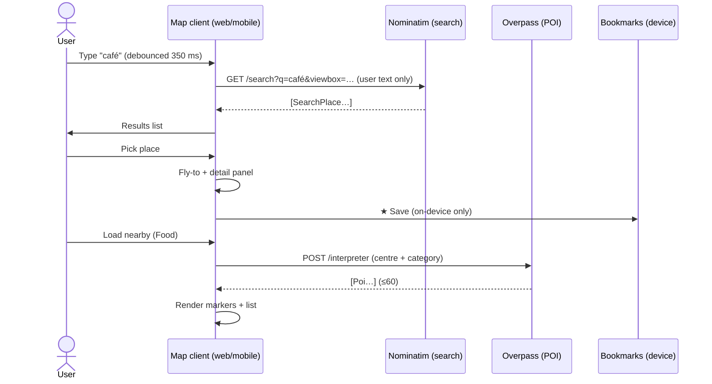
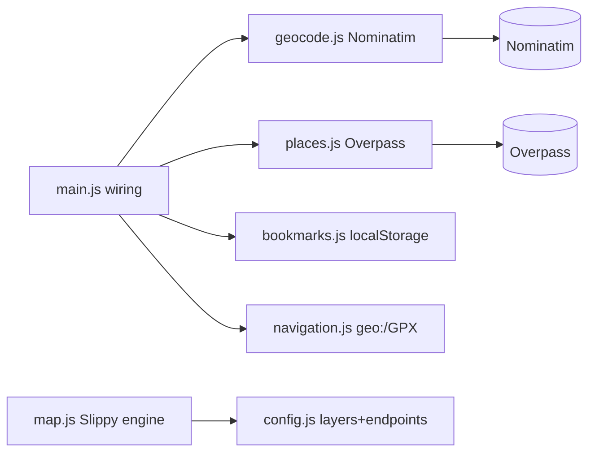
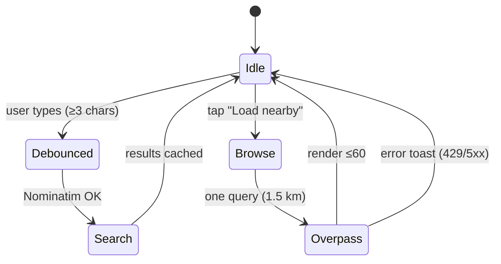

# 12 — Map Search & Places (Sequence + Components)

**Traceability:** FR-07, FR-08, FR-10, FR-15, FR-17 · NFR-02, NFR-06, NFR-07

## Sequence: search → pick → save/route

## Component diagram (web)

## Activity: POI browse guardrails

## Notes

- Friend/shared coordinates **never** enter Nominatim/Overpass requests.
- All results carry ODbL attribution; removal is a QA blocker.
