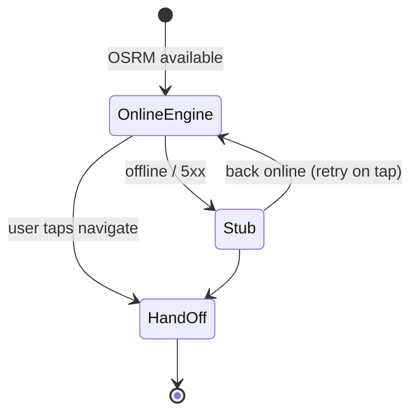
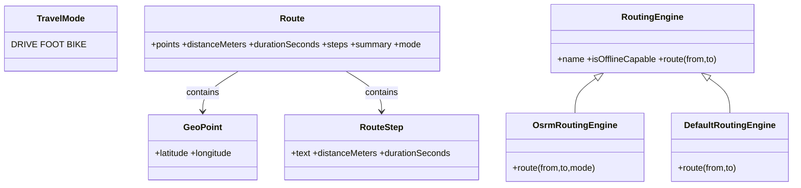

# 13 — Routing & Navigation (Sequence + State)

**Traceability:** FR-09, FR-12, FR-16 · NFR-03, NFR-06

## Sequence: compute route → hand off

```mermaid
sequenceDiagram
  actor U as User
  participant M as Map client
  participant R as OSRM (routing)
  participant X as Nav app (geo:)
  U->>M: Enter from/to + mode (driving/foot/bike)
  M->>R: GET /route/v1/{profile}/{lon,lat};… (steps=true)
  R-->>M: Route + polyline + steps
  M->>M: Render line + turn-by-turn list
  U->>M: Tap "Navigate (OSM)" / "Navigate (geo:)"
  M->>X: geo:lat,lon?from=…&q=label (or OSM directions URL)
  X-->>U: External nav (works offline if app has packs)
```

## Routing fallback states (mobile)



## Class sketch (domain)



## Notes

- OSRM demo is not production; Valhalla/GraphHopper plugs into
  `RoutingEngine` without touching features.
- GPX export (`navigation.js routeToGpx`) targets OsmAnd/Organic Maps.
