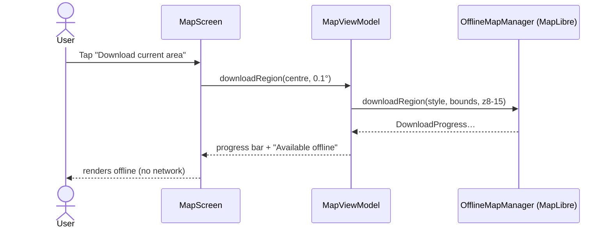
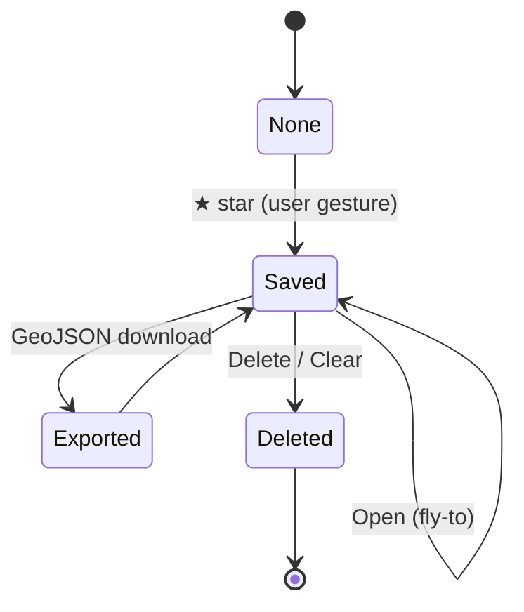
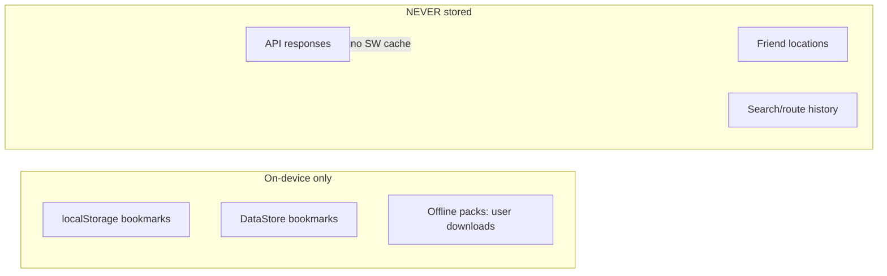

# 14 — Offline Packs & Bookmarks (State + Data)

**Traceability:** FR-11, FR-13 · NFR-08, NFR-14

## Sequence: download offline pack (mobile)

## State: bookmark lifecycle (web + mobile)

## Storage rules

## Notes

- Web offline = shell + bookmarks only. Mobile offline = shell of app +
  vector packs + bookmarks. Tile bulk-caching on web is forbidden (ToS).
- Bookmarks are not synced; any future sync needs a threat analysis.
