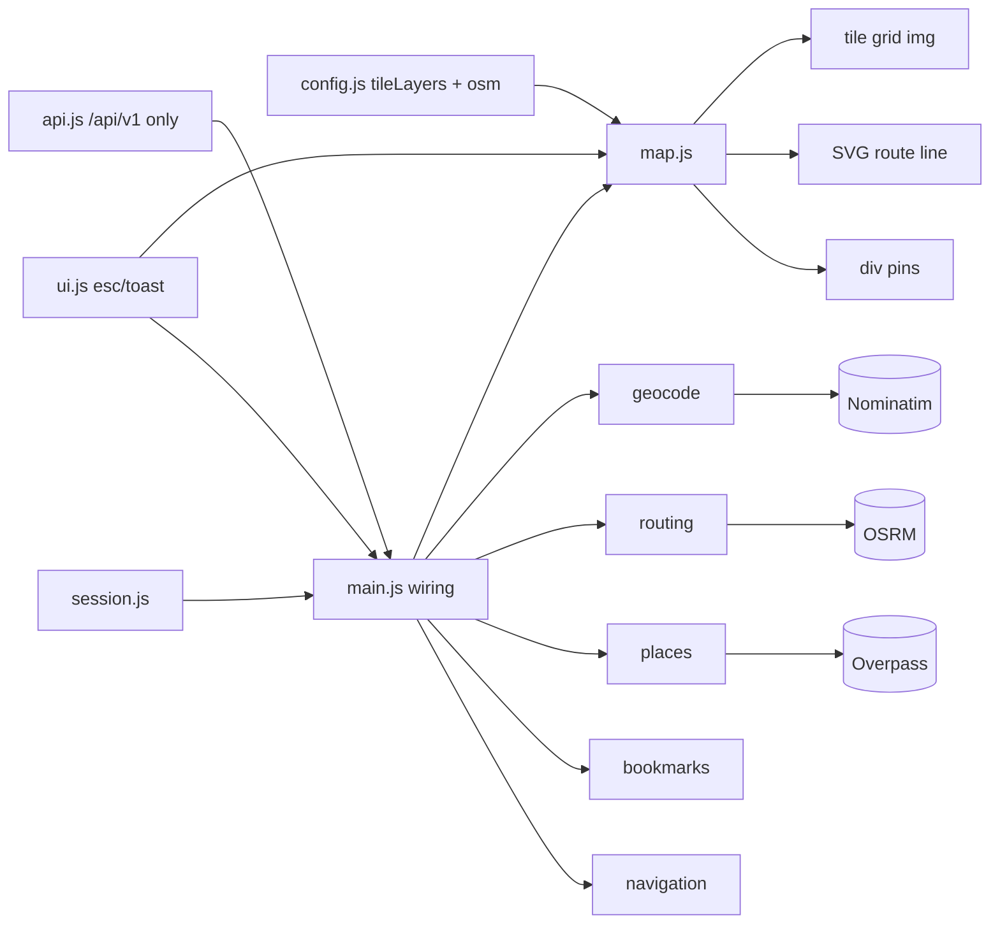
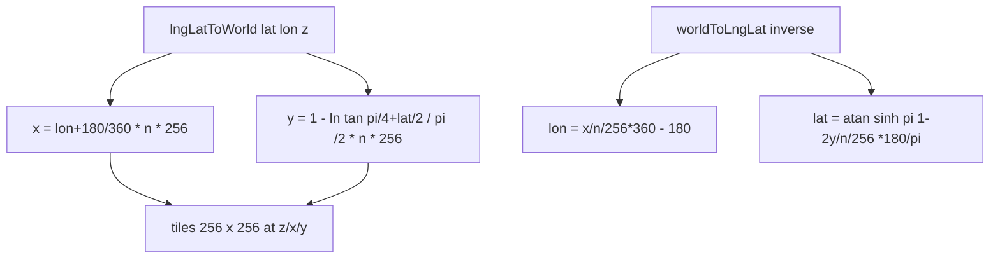
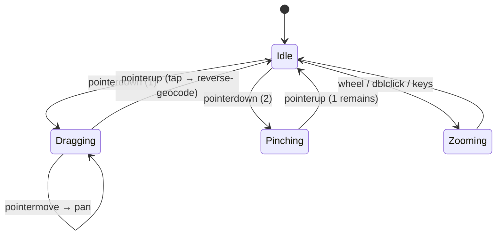

# 15 — Web Slippy Engine (Components + Projection)

**Traceability:** FR-06 · NFR-01, NFR-09, NFR-10

## Component diagram (web)

## Web Mercator projection (math)

## Pointer state machine (map input)

## Compliance gates (enforced by QA)

- Tiles only from `tileLayers` hosts (CARTO/Wikimedia); never
  `tile.openstreetmap.org`.
- `#map-attribution` always rendered (ODbL). CSP `img-src`/`connect-src`
  match `config.js`.
